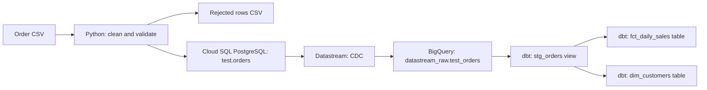

# Order Data Pipeline: Python, PostgreSQL, Datastream, BigQuery and dbt

An end-to-end data engineering project. Python validates synthetic order CSV data
and loads accepted rows into PostgreSQL. Datastream replicates changes to BigQuery
through CDC, and dbt builds tested daily-sales and customer models.

**Stack:** Python · pandas · psycopg · Cloud SQL for PostgreSQL 14 · Datastream ·
BigQuery · dbt · GitHub Actions

**Scope:** small synthetic datasets and manual execution. The GCP resources were
configured in the console, not with infrastructure as code. This project does not
claim production readiness, large-scale performance or automated scheduling.

## What this demonstrates

- **Data validation:** Python separates invalid CSV rows with reasons and upserts
  accepted orders, so replays do not create duplicate records.
- **Change data capture:** Datastream replicates PostgreSQL inserts, updates and
  deletes to BigQuery. Source and replica values were compared by hand.
- **dbt modeling and testing:** a staging view and two marts with 17 data tests,
  including a test that checks revenue totals match across the two marts.
- **Error detection and recovery:** an injected zero-value completed order failed a
  staging test, and all tests passed again after the source was corrected.
- **Documentation and CI:** a [data dictionary](docs/data_dictionary.md) defines every
  field and model grain. GitHub Actions checks every pull request.

## Architecture



| Layer | Responsibility |
| --- | --- |
| Python and pandas | Read the CSV, normalize values, validate rows, write accepted and rejected files, upsert into PostgreSQL |
| PostgreSQL | Source of truth for current order records |
| Datastream | Replicate source changes to BigQuery in merge mode |
| BigQuery | Store the replicated table and run analytical SQL |
| dbt | Build models and run data tests |

## Data models

| Model | Materialization | Grain | Purpose |
| --- | --- | --- | --- |
| `stg_orders` | View | One row per `order_id` | Normalize status (`lower(trim())`) and keep every status |
| `fct_daily_sales` | Table | One row per `order_date` with completed orders | Daily completed-order count and revenue |
| `dim_customers` | Table | One row per `customer_id` | First and last order dates, order counts and completed revenue per customer |

Field definitions, types and validation coverage are in the
[data dictionary](docs/data_dictionary.md) and [orders_schema.yml](models/orders_schema.yml).

## Key design decisions

- **Replicate current state, not event history.** Datastream merge mode keeps one row
  per order. Queries stay simple, but a later refund, cancellation or deletion changes
  a past date's totals on the next dbt run. Change history would need a
  different design, such as dbt snapshots.
- **Reject duplicate IDs within a file together.** If two rows in one CSV share an
  `order_id`, both are rejected instead of keeping one at random. Repeats across
  separate loads are handled by a PostgreSQL `ON CONFLICT` upsert.
- **Count completed orders only as revenue.** Pending, cancelled and refunded orders
  are excluded. This is named `completed_revenue` rather than revenue, because it does
  not model refunds as transactions, taxes or currencies.
- **Derive the customer dimension from orders.** The source has no customer table, so
  `dim_customers` is built from `stg_orders`. Its `relationships` test is structural
  for now. It becomes a real check once an independent customer source exists.
- **Keep credentials out of CI.** CI parses the dbt project with a placeholder profile.
  This catches broken YAML, Jinja and `ref()`/`source()` references without storing
  GCP credentials in GitHub. Data tests run against BigQuery in Cloud Shell.

## Validation results

| Check | Observed result |
| --- | --- |
| CSV validation | 11 input rows: 3 accepted, 8 rejected with reasons |
| Replay safety | Loading the same CSV twice kept 3 orders with unchanged values |
| CDC replication | All 3 accepted orders appeared in BigQuery with matching values |
| Source vs. mart | Both returned 1 completed order and 25.50 for 2026-10-21 |
| Error detection | 7 staging tests passed, then 6 passed and 1 failed after setting a completed amount to 0, then 7 passed after the fix |
| Full dbt build | 2026-11-20, dbt 2.0.8: 3 models and 17 tests, 20 of 20 succeeded |

Evidence: [validation record](docs/validation.md) ·
[recovery run results](docs/execution/recovery/run_results.json) ·
[recovery manifest](docs/execution/recovery/manifest.json)

## Continuous integration

[`ci.yml`](.github/workflows/ci.yml) runs on every pull request and every push to `main`.
It installs [`requirements.txt`](requirements.txt), checks Python syntax, and runs
`dbt parse` and `dbt ls` with [`profiles.yml.example`](profiles.yml.example).
It does not connect to BigQuery.

## Repository layout

```text
.github/workflows/ci.yml       CI pipeline
inspect_orders.py              Validate the CSV and upsert accepted rows
check_connection.py            Read back stored orders from PostgreSQL
data/                          Practice CSV and validated/rejected outputs
models/
    orders_sources.yml         BigQuery source (replicated table)
    orders_schema.yml          Model and column descriptions and tests
    staging/stg_orders.sql
    marts/fct_daily_sales.sql
    marts/dim_customers.sql
tests/                         Custom SQL data tests
docs/
    runbook.md                 Step-by-step run and verification guide
    data_dictionary.md         Field definitions, grain and validation coverage
    validation.md              Observed validation sequence
    execution/recovery/        dbt artifacts from the error-recovery run
```

## How to run

This needs the existing GCP lab resources (Cloud SQL, Datastream and BigQuery) and
your own Google credentials. The full steps, including the Cloud SQL Auth Proxy,
CDC freshness checks and the error-injection experiment, are in the
**[runbook](docs/runbook.md)**.

```bash
cp .env.example .env               # set GCP_PROJECT and the other values
set -a && source .env && set +a
python inspect_orders.py           # needs the Cloud SQL Auth Proxy running
dbt build                          # build all models and run all tests in BigQuery
```

## Limitations

- CDC checks and source-to-mart comparisons were run by hand, not automated.
- The Python validator is a learning implementation. It does not cover every
  database constraint, such as all numeric precision, range and ID-normalization
  edge cases.
- The upsert rewrites `updated_at` even when business values are unchanged, so a
  replay can still produce CDC events.
- PostgreSQL connection settings are hard-coded in the Python scripts.
- A separate `run_results.json` from the failed test run was not preserved. The
  2026-11-20 build result was taken from the console output.
- Not done: BigQuery partitioning benchmarks, automated deployment, scheduling and a
  controlled Datastream pause/resume test.

## Next steps

These are planned and not yet implemented:

1. Split the validation logic in `inspect_orders.py` into functions and test them with
   pytest in CI.
2. Read PostgreSQL connection settings from environment variables.
3. Make ingestion non-interactive and add an automated source-to-BigQuery
   reconciliation check.
4. Orchestrate ingestion, CDC freshness checks and dbt with a scheduler such as Airflow.
