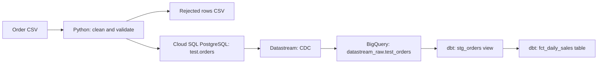

# Order Data Pipeline: Python, PostgreSQL, Datastream, BigQuery and dbt

A hands-on data engineering project that validates synthetic order CSV data
with Python, loads accepted rows into PostgreSQL, replicates changes to
BigQuery through Datastream, and builds daily completed-order revenue with dbt.

This project uses small synthetic datasets and manual execution.
It does not claim production readiness, large-scale performance,
or automated scheduling.

## Project goals

- Clean and validate order CSV data with Python and pandas.
- Save rejected rows with validation reasons.
- Load accepted orders into PostgreSQL using upserts.
- Verify that repeated loading does not create duplicate orders.
- Confirm CDC replication from PostgreSQL to BigQuery.
- Calculate daily revenue from completed orders only.
- Detect invalid data with dbt tests and verify recovery after correction.

## Architecture



### Service responsibilities

- **Python and pandas:** read the CSV, normalize values, validate rows,
  and separate accepted and rejected records.
- **PostgreSQL:** store current order records.
- **Datastream:** replicate source inserts, updates, and deletes to BigQuery.
- **BigQuery:** store replicated data and execute analytical SQL.
- **dbt:** manage transformation models and data tests.

## Existing lab environment

| Component | Configuration |
| --- | --- |
| Google Cloud project | `bigquery-access-gcp` |
| Cloud SQL instance | `postgres-db` |
| PostgreSQL version | 14 |
| PostgreSQL database | `portfolio` |
| Source table | `test.orders` |
| Publication | `portfolio_publication` |
| Cloud SQL and Datastream region | `us-west2` |
| BigQuery dataset location | `US` |
| Replicated table | `datastream_raw.test_orders` |
| dbt dataset | `dbt_dev` |
| Local proxy endpoint | `127.0.0.1:9473` |

These instructions use the existing lab resources.
They are not a complete infrastructure provisioning guide.

For another environment, update the project, connection name,
database settings, dbt source configuration, and dbt profile.

## Repository files

```text
check_connection.py
inspect_orders.py
dbt_project.yml
data/
    orders_practice.csv
    rejected_orders.csv
    validated_orders.csv
models/
    orders_sources.yml
    orders_schema.yml
    staging/
        stg_orders.sql
    marts/
        fct_daily_sales.sql
tests/
    assert_valid_order_amount.sql
docs/
    validation.md
    execution/
        recovery/
            run_results.json
            manifest.json
    archive/
        original-lab-readme.md
```

The archived README describes an earlier lab and is retained for reference.
Use this README for the current order pipeline.

## Business rules

| Field or metric | Rule |
| --- | --- |
| Order ID | Required, positive integer, unique |
| Customer ID | Required, positive integer |
| Order date | Must be a valid date |
| Status | `pending`, `completed`, `cancelled`, or `refunded` |
| Amount | Must be numeric and nonnegative |
| Completed order amount | Must be greater than zero |
| Completed revenue | Includes only orders currently marked `completed` |

This simplified model excludes pending, cancelled, and refunded orders
from completed revenue. It does not model separate refund transactions,
taxes, currencies, or accounting net revenue.

Duplicate order IDs within the input file are rejected together rather
than choosing one record arbitrarily.

Duplicates between separate loads are handled by PostgreSQL upserts.

## 1. Start the existing services

1. Start the `postgres-db` Cloud SQL instance.
2. Wait until the instance is ready.
3. Resume the existing Datastream stream.
4. Confirm that the stream status is `Running`.

A running stream does not by itself prove that all source changes
are already visible in BigQuery.

## 2. Prepare the Python environment

Open Cloud Shell and enter the repository directory.

For a fresh Python environment:

```bash
python -m venv .venv
source .venv/bin/activate
python -m pip install pandas "psycopg[binary]"
```

If using an existing environment, confirm that it contains both packages.

The Python scripts request the PostgreSQL password through `getpass()`.
Do not put passwords in source code or commit credentials.

## 3. Start the Cloud SQL Auth Proxy

In the first Cloud Shell terminal:

```bash
cloud-sql-proxy bigquery-access-gcp:us-west2:postgres-db --port 9473
```

Keep this terminal running.

In a second terminal, enter the repository directory and activate
the Python environment that contains pandas and psycopg.

The scripts connect to:

```text
Host: 127.0.0.1
Port: 9473
Database: portfolio
User: postgres
```

The lab uses the `postgres` account for manual practice.
A deployed application should use an account with only the permissions
needed for its work.

## 4. Validate and load the CSV

Run:

```bash
python inspect_orders.py
```

The script:

1. Reads CSV fields as strings.
2. Trims and normalizes order status.
3. Parses dates and numeric amounts.
4. Records validation errors.
5. Separates passing and rejected rows.
6. Writes output CSV files.
7. Prepares typed values for PostgreSQL.
8. Upserts accepted rows into `test.orders`.

This script includes database writes; it is not only an inspection tool.

### Expected sample results

The final practice CSV contains 11 rows:

- 3 rows pass the implemented checks.
- 8 rows are rejected.
- Both records with order ID `910001` are rejected as duplicates.

Expected accepted orders:

| order_id | customer_id | order_date | status | amount |
| --- | --- | --- | --- | --- |
| 910002 | 102 | 2026-10-21 | pending | 50.00 |
| 910003 | 103 | 2026-10-21 | cancelled | 30.00 |
| 910004 | 104 | 2026-10-21 | completed | 25.50 |

Rejected rows and their reasons are saved in `data/rejected_orders.csv`.
Rows passing the current checks are saved in `data/validated_orders.csv`.

The loader prepares amounts from the original strings using `Decimal`.
The current validation is a learning implementation: it does not yet
cover every database constraint, including all numeric precision,
range, and normalized-ID edge cases.

## 5. Verify PostgreSQL loading and repeatability

Run:

```bash
python check_connection.py
```

Expected output includes the three accepted orders and:

```text
Stored orders: 3
```

Run the ingestion script again, then repeat the check:

```bash
python inspect_orders.py
python check_connection.py
```

The selected order count should remain 3 and the values should remain
50.00, 30.00, and 25.50.

The loader uses:

```sql
ON CONFLICT (order_id) DO UPDATE
```

An existing order is updated instead of creating another row.

The current implementation performs an update even when business values
are unchanged. Therefore, `updated_at` may change and another CDC event
may be generated. Repeatability here means no duplicate orders and stable
business values, not an absence of writes.

## 6. Verify Datastream replication in BigQuery

Run in BigQuery:

```sql
SELECT
    order_id,
    customer_id,
    order_date,
    status,
    amount
FROM `bigquery-access-gcp.datastream_raw.test_orders`
WHERE order_id IN (910002, 910003, 910004)
ORDER BY order_id;
```

Compare the keys and values against the PostgreSQL results.

All three accepted orders were observed in BigQuery with matching values.

### CDC latency and freshness

CDC is asynchronous. A successful PostgreSQL update does not mean the
change is immediately visible in BigQuery.

The lab was configured with a 15-minute BigQuery staleness limit.
This is not a guaranteed end-to-end replication time.

To request the freshest available result, run both statements together:

```sql
SET @@max_staleness_override = INTERVAL 0 SECOND;

SELECT order_id, status, amount
FROM `bigquery-access-gcp.datastream_raw.test_orders`
WHERE order_id = 910004;
```

This requests application of pending changes already delivered to BigQuery.

- It cannot retrieve changes that Datastream has not yet delivered.
- Applying pending changes at query time can increase execution time
  and processing cost.
- It does not permanently change the table's staleness configuration.
- The override applies to the current script or session, not to a
  separate dbt invocation.

## 7. Run the dbt models

The existing Cloud Shell lab has dbt installed in `~/venvs/dbt`.

```bash
source ~/venvs/dbt/bin/activate
dbt run --select +fct_daily_sales
```

The `+` includes upstream dependencies such as `stg_orders`.

This requires an existing BigQuery dbt profile matching the profile name
in `dbt_project.yml`. A different machine must configure its own dbt
installation, credentials, project, dataset, and location.

### Models

**`stg_orders`**

- Materialized as a view.
- Reads the replicated source table.
- Normalizes status using `lower(trim(status))`.
- Retains all order statuses.

**`fct_daily_sales`**

- Materialized as a table.
- Filters to `status = 'completed'`.
- Groups by `order_date`.
- Produces `order_count` and `completed_revenue`.

Because the mart is a table, source changes do not automatically rebuild it.
Run dbt again when the mart needs to reflect new source data.

## 8. Validate completed revenue

Query the mart:

```sql
SELECT order_date, order_count, completed_revenue
FROM `bigquery-access-gcp.dbt_dev.fct_daily_sales`
WHERE order_date = DATE '2026-10-21';
```

Compare it with a direct source calculation:

```sql
SELECT
    order_date,
    COUNT(*) AS order_count,
    SUM(amount) AS completed_revenue
FROM `bigquery-access-gcp.datastream_raw.test_orders`
WHERE order_date = DATE '2026-10-21'
  AND LOWER(TRIM(status)) = 'completed'
GROUP BY order_date;
```

Both queries returned:

| order_date | order_count | completed_revenue |
| --- | --- | --- |
| 2026-10-21 | 1 | 25.50 |

The three sample orders total 105.50 across all statuses,
but only 25.50 qualifies as completed revenue.

Additional completed orders on the same date would also be included
in the daily mart.

## 9. Run data tests

```bash
dbt test --select stg_orders
```

The seven tests check:

1. Unique order IDs.
2. Non-null order IDs.
3. Non-null order dates.
4. Non-null amounts.
5. Non-null statuses.
6. Accepted status values.
7. Nonnegative amounts and positive amounts for completed orders.

The custom SQL test returns violating rows:

```sql
select
    order_id,
    status,
    amount
from {{ ref('stg_orders') }}
where amount < 0
   or (status = 'completed' and amount = 0)
```

Zero returned rows means the test passes.
One or more returned rows means it fails.

## 10. Verify error detection and recovery

The following experiment was performed on synthetic order `910004`.

| Stage | Action | Observed result |
| --- | --- | --- |
| Baseline | Run staging tests | 7 passed |
| Inject error | Change completed order amount from 25.50 to 0.00 | Change observed in BigQuery |
| Detect error | Run staging tests | 6 passed, 1 failed |
| Correct source | Restore amount to 25.50 | Correction observed in BigQuery |
| Verify recovery | Run staging tests again | 7 passed |

### Inject the test error in PostgreSQL

```sql
UPDATE test.orders
SET amount = 0,
    updated_at = CURRENT_TIMESTAMP
WHERE order_id = 910004
  AND status = 'completed'
  AND amount = 25.50
RETURNING order_id, status, amount;
```

Confirm the changed value in BigQuery before running the dbt test.
Do not rebuild the revenue mart with intentionally invalid data.

### Restore the original value

```sql
UPDATE test.orders
SET amount = 25.50,
    updated_at = CURRENT_TIMESTAMP
WHERE order_id = 910004
  AND status = 'completed'
  AND amount = 0
RETURNING order_id, status, amount;
```

Confirm that BigQuery shows 25.50, then rerun the tests.

This experiment demonstrates data-quality error detection and correction.
It is not a complete disaster-recovery or Datastream pause/resume test.

## Evidence and limitations

- `docs/validation.md` records the observed validation sequence.
- `docs/execution/recovery/run_results.json` preserves the recovery test results.
- `docs/execution/recovery/manifest.json` preserves the model and test definitions.
- A separate failure `run_results.json` was not preserved.
- Earlier files under `docs/execution/` belong to the previous lab execution
  and should not be treated as results for this extension.
- The final recovery artifacts alone do not prove every earlier state.
- CDC checks and expected aggregate comparisons were performed manually.
- BigQuery partitioning benchmarks, automated deployment, and a controlled
  pause/resume experiment have not been completed in this extension.

## Troubleshooting

| Symptom | Check or action |
| --- | --- |
| `dbt: command not found` | Activate `~/venvs/dbt/bin/activate` in the existing Cloud Shell lab. |
| Duplicate `data_tests` YAML key | Keep one `data_tests` key per column and align column entries correctly. |
| Proxy port already in use | Check for an existing proxy process before starting another one. |
| Proxy reports invalid token JSON or metadata EOF | Investigate Cloud Shell authentication. Reconnecting resolved the observed lab issue; this is not a universal fix. |
| PostgreSQL changes are not visible in BigQuery | Check stream status and distinguish source changes, delivery, and BigQuery application. |
| dbt tests pass but the mart is old | Tests do not rebuild the mart; rerun the models after source data is ready. |
| `fatal: not a git repository` | Use the cloned repository directory containing `.git`. |
| Git cannot detect an email address | Configure the repository's author name and email before committing. |

## Stop the lab

When finished:

1. Pause Datastream and wait for `Paused`.
2. Stop Cloud SQL and wait for `Stopped`.
3. Stop the local proxy with `Ctrl+C`.

Closing the browser does not stop Cloud SQL or Datastream.
Storage and other applicable charges may remain after stopping compute.

When pausing CDC, consider replication-slot health, retained WAL,
and source storage capacity. Do not assume a paused stream can resume
indefinitely without checking source-log availability.

## References

- [dbt data tests](https://docs.getdbt.com/docs/build/data-tests)
- [BigQuery system variables and freshness overrides](https://docs.cloud.google.com/bigquery/docs/reference/system-variables)
- [BigQuery CDC](https://docs.cloud.google.com/bigquery/docs/change-data-capture)
- [Datastream stream lifecycle operations](https://docs.cloud.google.com/datastream/docs/run-a-stream)